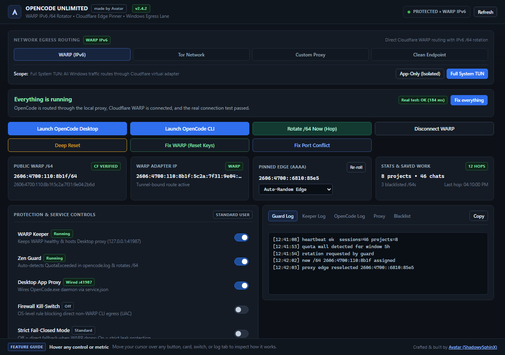

# PLEASE GIVE PROPER CREDITS. JUST DONT REBRAND AND LAUNCH IT AS YOURS.
# NEW VERSION-2.4.2 (hotfix: 45s keeper flapping, socket drops, drafts.sqlite free-limit unlock, WireGuard enforcement, auto-resume)
# Opencode-Unlimited-Limit-Bypass

[](https://github.com/ShadowySphinX/Opencode-Unlimited-Limit-Bypass-)
[](https://github.com/ShadowySphinX)
[](https://github.com/ShadowySphinX/Opencode-Unlimited-Limit-Bypass-)
[](https://opensource.org/licenses/MIT)

Automatic rate-limit rotator, multi-egress proxy router, and autonomous session auto-resume for **OpenCode Desktop** and **OpenCode CLI**.



OpenCode enforces free-tier message limits based on your inbound public IP address (`/64` prefix on IPv6, `/32` on IPv4) and Cloudflare edge connection affinity. 

This tool monitors OpenCode logs in real time, catches quota and rate-limit errors the second they appear, automatically cycles your identity (fresh IPv6 `/64`, Tor circuit, or proxy pool node), and **automatically sends "continue" to your running session** so generation continues uninterrupted without losing your chat history.

---

## Table of Contents
1. [What's New in v2.4.2](#whats-new-in-v242)
2. [Prerequisites & Downloads](#prerequisites--downloads-what-you-need)
3. [Quick Start (Windows)](#quick-start-windows)
4. [Recommended Settings for Every Method](#recommended-settings-for-every-method)
5. [How Limit Reset Works on Existing Chats](#how-limit-reset-works-on-existing-chats)
6. [Restricted Regions Guide (Russia, Iran, China)](#restricted-regions-guide-russia-iran-china)
7. [Troubleshooting Playbook ("What to do when something happens")](#troubleshooting-playbook-what-to-do-when-something-happens)
8. [Routing Architecture](#routing-architecture)
9. [Linux Setup (Headless & VPS)](#linux-setup-headless--vps)
10. [Building from Source](#building-from-source)

---

## What's New in v2.4.2

* **Permanent Fix for 45s WARP Flapping & `ECONNRESET`:**
  * Added early-exit guard in `warp_keeper.py` (`if connected: return True`) to eliminate adapter teardowns during active generations.
  * Replaced destructive protocol flipping with `ensure_warp_protocol("wireguard")` so WireGuard is locked in without adapter resets.
  * Expanded handshake grace period from 2s to **8s**, allowing in-flight `Connecting` / `Reconnecting` states to resolve naturally.
  * Banned nuclear `registration delete` / `registration new` from routine loops; now uses non-destructive key rotation (`tunnel rotate-keys`).
* **Existing Chat Auto-Unlock & History Preservation:**
  * Automatically wipes client-side rate limit lockouts (`free-limit`, `go-upsell`) from `%APPDATA%\ai.opencode.desktop\drafts.sqlite` upon IP rotation.
  * Preserves 100% of chat history and conversation context in the `document` table while clearing the lockout banner.
  * Dispatches background window reload (`Ctrl+R`) and `continue` keystrokes to resume existing chat threads seamlessly.
* **Rock-Solid Streaming Proxy:**
  * Enabled native TCP keepalive (`SIO_KEEPALIVE_VALS` on Windows, `TCP_KEEPIDLE` on Linux) and 15-minute idle streaming ceiling in `zen_proxy.py` for massive reasoning models (DeepSeek V4.1, MiMo-V2.6).
* **Detached Desktop Launching:**
  * OpenCode Desktop now launches as an independent detached process (`os.startfile`), so it stays open even if the launcher or terminal is closed.

---

## Prerequisites & Downloads (What You Need)

To get the most out of OpenCode Unlimited, ensure you have the following installed:

| Component | Purpose | Requirement | Official Link |
| :--- | :--- | :---: | :--- |
| **OpenCode (Desktop or CLI)** | The AI coding assistant | **Required** | [Download OpenCode](https://opencode.ai/) or [GitHub Releases](https://github.com/opencode-ai/opencode) |
| **Cloudflare WARP** | Egress IPv6 `/64` provider | **Required** (for WARP modes) | [Download Cloudflare WARP (1.1.1.1)](https://one.one.one.one/) |
| **Microsoft WebView2 Runtime** | Powers the modern dashboard UI | **Pre-installed** on Win 10/11 | [WebView2 Evergreen Bootstrapper](https://developer.microsoft.com/en-us/microsoft-edge/webview2/) |
| **Python 3.8+** | Only needed if running from source | Optional (binary is standalone) | [Download Python](https://www.python.org/downloads/) |
| **Tor Expert Bundle** | Decentralized IP circuit rotation | Optional (for Tor mode) | [Tor Project Downloads](https://www.torproject.org/download/tor/) *(or use in-app 1-click download)* |
| **xdotool** | Linux window focus & reload | Optional (Linux GUI users) | `sudo apt install xdotool` / `sudo dnf install xdotool` |

---

## Quick Start (Windows)

> You do **not** need Python installed. Everything is bundled into a single standalone program.

1. **Download & Run:**
   * Download **`OpencodeUnlimited-Multi.exe`** from the repository releases or clone.
   * Double-click to launch the dashboard.
2. **Verify Protection Controls (Left Panel):**
   * Ensure these switches are **ON** (they are on by default):
     * **WARP Keeper:** ON
     * **Zen Guard:** ON
     * **Desktop App Proxy:** ON
     * **Auto-Resume on Bypass:** ON (enables walk-away mode)
3. **Use OpenCode Normally:**
   * Open OpenCode Desktop or run `opencode` in your command prompt/terminal.
   * Work normally. When you hit a free-tier rate limit wall, the app rotates your IP and automatically resumes your session. You never have to wait for timers to reset.

---

## Recommended Settings for Every Method

Select the method that best matches your network environment:

### Method 1: Cloudflare WARP (Default / Recommended for 99% of Users)
* **Best for:** Fast, zero-lag streaming with unlimited IPv6 `/64` rotation.
* **Recommended Settings:**
  * **Scope (Windows):** `Full System TUN` (ensures rock-solid stability and zero proxy bottlenecks).
  * **Scope (Linux / VPS):** `App Only (Isolated)` on port `40000` (strictly whitelists SSH and prevents VPS dropouts).
  * **Protocol:** `WireGuard` (bypasses MASQUE UDP 443 ISP throttling).
  * **Switches:** Turn ON **WARP Keeper**, **Zen Guard**, and **Auto-Resume**.

### Method 2: Clean WireGuard Endpoints (Best for ISP Throttling / Restricted Countries)
* **Best for:** Users in Russia, Iran, China, or university/corporate networks where Cloudflare's default Anycast IPs are throttled or blocked (`CF_HAPPY_EYEBALLS_MITM_FAILURE`).
* **Recommended Settings:**
  1. Open the dashboard and click the **Clean Endpoint** tab.
  2. Click **Ping Test** (benchmarks 27 unblocked Anycast endpoints in under 1s).
  3. Select the node with the lowest ping (e.g. `162.159.192.1:2408` or port `500` / `4500`).
  4. Click **Apply Endpoint**. WireGuard locks directly to that unthrottled node.

### Method 3: Tor Network (Best for Strict Censorship & Maximum Privacy)
* **Best for:** Users whose networks completely block UDP / WireGuard traffic, or who require decentralized exit nodes.
* **Recommended Settings:**
  1. Click the **Tor Network** tab on the dashboard.
  2. Click **Start Tor Daemon** (launches an isolated portable Tor daemon on `127.0.0.1:9050` with control port `9051`).
  3. If you already run **Tor Browser**, the app automatically hooks into port `9150`.
  4. On rate limits, a `SIGNAL NEWNYM` command rotates to a fresh global IPv4 exit node in under 1 second.

### Method 4: Custom Proxy Pool (Clash / V2Ray / Xray / sing-box / Residential)
* **Best for:** Users with established proxy subscriptions or local proxy clients.
* **Recommended Settings:**
  1. Click the **Custom Proxy** tab.
  2. Paste your local proxy address (e.g. `127.0.0.1:7890` or `127.0.0.1:10808`).
  3. Format supported: Single address or multi-line pool (separated by newlines, commas, or semicolons).
  4. Choose protocol: **SOCKS5** or **HTTP**.
  5. The proxy engine automatically rotates round-robin through your pool whenever a rate limit occurs.

---

## How Limit Reset Works on Existing Chats

A common concern is whether rotating limits requires starting a brand-new chat. **No. It resets and resumes existing chats seamlessly.**

```
[ User Active Chat / Session ]
          │
          ▼
┌──────────────────────────────┐
│  Layer 1: Client SQLite Lock │  ──> Stored locally in %APPDATA%\ai.opencode.desktop\drafts.sqlite
│       ('free-limit' key)     │      Disables the UI prompt bar & displays the red upsell banner.
└──────────────┬───────────────┘
               │ (Automatically purged by Zen Guard / Deep Reset)
               ▼
┌──────────────────────────────┐
│  Layer 2: Upstream Cloudflare│  ──> Evaluated per egress IP (CF-Connecting-IP).
│       Server Rate Limit      │      Completely stateless; does NOT track session IDs.
└──────────────────────────────┘
```

1. **Server-Side Quota (IP-Based):** OpenCode's backend API checks rate limits **strictly by the incoming public IP address**. It does not bind limits to conversation IDs or session IDs. When your `/64` IPv6 prefix rotates, the server sees a brand-new IP with zero usage.
2. **Client-Side Lockout Removal:** When OpenCode Desktop hits a rate limit, the local Electron app writes a lockout timestamp into `%APPDATA%\ai.opencode.desktop\drafts.sqlite` (`state` table). Zen Guard automatically deletes this key (`DELETE FROM state WHERE key IN ('free-limit', 'go-upsell')`).
3. **History Preservation:** The `document` table and `session_v2` table—where your message history, system prompts, code blocks, and context live—are **never modified**.
4. **Window Reload & Resume:** A silent reload (`Ctrl+R`) is sent to OpenCode Desktop, which refreshes the view, removes the red banner, unlocks the prompt box, and sends `continue{ENTER}` so generation resumes right where it stopped.

---

## Troubleshooting Playbook ("What to do when something happens")

### 1. What to do when you hit a rate limit wall
* **Automatic Behavior:** If **Zen Guard** and **Auto-Resume** are ON, you do not need to do anything. Within ~10 seconds, your IP rotates, the client database unlocks, the window reloads, and `continue` is dispatched automatically.
* **Manual Override:** If you want an instant identity reset, click **` Zen Hop (/64)`** on the dashboard, or run `python src/zen_hop.py` (Linux: `opencode-unlimited-hop`).

### 2. What to do if OpenCode shows "You've reached your free usage limit" banner in an existing chat
* **Cause:** The client-side Electron app is still holding the lockout timestamp in `drafts.sqlite`.
* **Fix:** Click **` Clear Free Limit`** (or **Deep Reset**) on the dashboard, or simply press `Ctrl+R` in OpenCode Desktop. The input bar will unlock immediately.

### 3. What to do if you get `Connection lost while reading the response: ECONNRESET`
* **Cause:** In v2.4.0 and older, WARP keeper checked protocol every 45 seconds, which tore down the virtual network adapter mid-stream while reasoning models (DeepSeek, MiMo) were thinking.
* **Fix in v2.4.2:** 
  1. Update to **v2.4.2** (the keeper now has `if connected: return True` and leaves active sockets alone).
  2. Ensure you are not running third-party VPNs (NordVPN, ExpressVPN) alongside WARP, as they fight over the Windows Wintun driver.
  3. Ensure **Desktop App Proxy** switch is ON (provides a 15-minute keepalive streaming buffer).

### 4. What to do if WARP keeps reconnecting or looping (`Connecting...`)
* **Cause:** ISP UDP packet drops or corrupt local WireGuard keys.
* **Fix:**
  1. Click **` Fix WARP (Reset Keys)`** on the dashboard. This rotates cryptographic keys without deleting your device identity.
  2. Switch to the **Clean Endpoint** tab, run a **Ping Test**, and click **Apply Endpoint** to bind to a reliable IP/port (e.g. port `2408` or `500`).

### 5. What to do if WARP shows "Network: unstable"
* **Notice:** Cloudflare WARP reports `Network: unstable` whenever ping latency exceeds 100ms or during initial packet bursts. This is **normal** and does **not** mean your internet is down.
* In v2.4.2, the app treats "unstable" as healthy traffic. Do not disconnect or delete your registration.

### 6. What to do if you get `CF_HAPPY_EYEBALLS_MITM_FAILURE`
* **Cause:** MASQUE protocol (UDP 443) blocked by ISP or stale Anycast routing.
* **Fix:** Click **` Fix WARP (Reset Keys)`** on the dashboard. The app automatically locks the tunnel into WireGuard mode, which bypasses MASQUE MITM checks.

### 7. What to do if port 42914 or 41987 is already in use
* **Cause:** A previous orphaned session did not release its socket.
* **Fix:** Click **Repair Service** on the dashboard. The app will terminate orphaned background tasks and cleanly relaunch the proxy.

---

## Routing Architecture

```
[ OpenCode Desktop / CLI ]
            │
            ▼ (HTTP / HTTPS via service.json)
   [ 127.0.0.1:41987 (Zen Proxy with TCP KeepAlive) ]
            │
    ────────┴───────────────────────────────────────────────────────
    │ Active Egress Mode Selection                                  │
    ─────────────────────────────────────────────────────────────────
    ├── [1] WARP (Full TUN Mode)    ──> Virtual Adapter (Wintun)    ──> System-wide Cloudflare VPN
    ├── [2] WARP (Isolated Mode)    ──> 127.0.0.1:40000 (SOCKS5)    ──> Cloudflare Edge [Fresh /64 IPv6]
    ├── [3] Clean Endpoint          ──> Clean WireGuard IP:2408     ──> Unblocked Anycast Edge
    ├── [4] Tor Network             ──> 127.0.0.1:9050 / 9150       ──> Tor 3-Hop Circuit [Fresh IPv4]
    └── [5] Custom Proxy Pool       ──> Node #1 -> Node #2 -> ...   ──> Round-Robin Upstream Nodes
```

---

## Linux Setup (Headless & VPS)

Run the automated one-shot installer:
```bash
bash install.sh
```

* **Compatibility:** Debian, Ubuntu, Fedora, Arch Linux, NixOS, and openSUSE.
* **Systemd Daemons:** Installs `opencode-unlimited-keeper.service` (root) and `opencode-unlimited-guard.service` (user).
* **Cloud VPS Safe:** Strictly whitelists SSH (port 22 and custom SSH ports) and runs in isolated proxy mode so default routing is never hijacked.
* **Existing Chat Unlock:** Automatically clears `~/.config/ai.opencode.desktop/drafts.sqlite` and dispatches `nohup opencode run --continue "continue" &` on every bypass.

---

## Building from Source

```bash
git clone https://github.com/ShadowySphinX/Opencode-Unlimited-Limit-Bypass-.git
cd Opencode-Unlimited-Limit-Bypass-
pip install -r requirements.txt
```

To compile the standalone Windows executable:
```powershell
powershell -ExecutionPolicy Bypass -File .\build_multi_exe.ps1
```

---

## Author & Credits

- Built & Maintained by **[Avatar (ShadowySphinX)](https://github.com/ShadowySphinX)**.
- Official Project Repository: [ShadowySphinX/Opencode-Unlimited-Limit-Bypass-](https://github.com/ShadowySphinX/Opencode-Unlimited-Limit-Bypass-)

---

## License

MIT License. Copyright (c) 2026 Avatar (ShadowySphinX).
